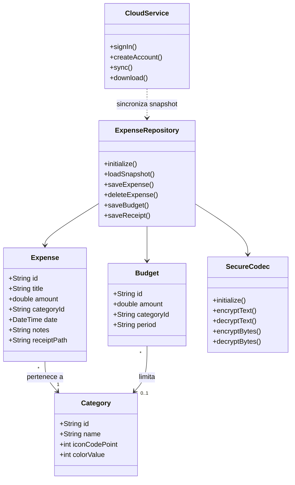

# Reporte técnico — Mis gastos

## Alcance

MVP móvil Flutter con registro, consulta, edición y eliminación de gastos; categorías y presupuestos; captura cifrada de tickets; alerta programada al alcanzar 80% del presupuesto semanal; y autenticación/sincronización opcionales con Firebase.

## Diagrama de clases

## Modelo de datos SQLite

| Entidad | Campos principales | Relaciones |
|---|---|---|
| `categories` | `id`, `name`, `icon_code_point`, `color_value` | Catálogo de seis categorías |
| `expenses` | `id`, `title_enc`, `amount_enc`, `category_id`, `spent_at`, `notes_enc`, `receipt_path` | `category_id` referencia `categories.id` |
| `budgets` | `id`, `amount_enc`, `category_id`, `period` | `category_id` referencia opcional a `categories.id`; `weekly` para presupuesto semanal |

El resumen semanal usa gastos de los últimos siete días. La tabla local se encuentra en el sandbox privado del sistema y exige relaciones SQLite habilitadas.

## Seguridad y privacidad

1. **Cifrado en reposo:** `cryptography` implementa AES-GCM de 256 bits con nonce nuevo por valor. Se cifran importes, títulos, notas, límites de presupuesto y contenido binario de tickets antes de persistirlos. SQLite conserva relaciones, fechas e identificadores técnicos.
2. **Gestión de llave:** una llave aleatoria se crea una sola vez y se guarda en `flutter_secure_storage` (Keychain en iOS / Keystore en Android). No se incluye llave ni secreto en el código.
3. **Autenticación:** Firebase Auth mantiene las credenciales y administra los tokens. La contraseña nunca se escribe a SQLite o Firestore.
4. **Aislamiento en la nube:** reglas de Firestore limitan lectura/escritura al UID autenticado y a las colecciones permitidas. La copia local se vincula al primer UID autenticado para impedir transferencias accidentales entre cuentas. Las reglas deben publicarse antes de activar la sincronización.
5. **Validación y errores:** controles de formato, rango y longitud preceden al guardado. Errores locales y de red se muestran; una falla de red no revierte el gasto local.
6. **Permisos mínimos:** cámara solo para capturar comprobantes; permiso de notificaciones para alertas locales. No se envían las fotos de tickets a Firestore.

## Componentes y flujo

- `ExpenseRepository` coordina SQLite, cifrado y archivos privados.
- `CloudService` autentica con Firebase Auth (inicio, alta y recuperación de contraseña) y replica snapshots del usuario en Firestore.
- La pantalla conserva operación local sin configuración remota; al iniciar sesión descarga la copia remota y sincroniza.
- Los errores de autenticación se presentan en español y no revelan respuestas internas del proveedor ni existencia de cuentas.
- Las eliminaciones sin red se guardan como tombstones locales y se confirman al completar una sincronización posterior.
- `BudgetNotifications` programa una notificación local cuando un gasto hace que el presupuesto semanal llegue al 80%.
- `image_picker`, `fl_chart`, `intl`, `sqflite`, `cryptography` y Firebase son dependencias externas.

## Verificación y límites

Se incluyen pruebas unitarias de las validaciones de dominio. El entorno de preparación no tiene Flutter instalado y no contiene configuración Firebase, así que compilación, ejecución en dispositivo, autenticación y sincronización reales quedan pendientes de ejecutarse con las instrucciones del README. El workspace tampoco tiene remoto GitHub; la publicación, PR y commits no se presentan como realizados.
