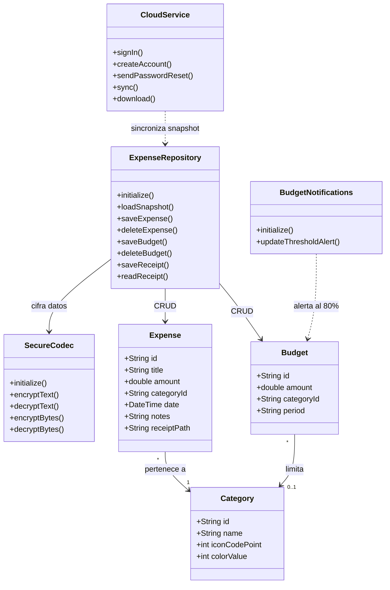
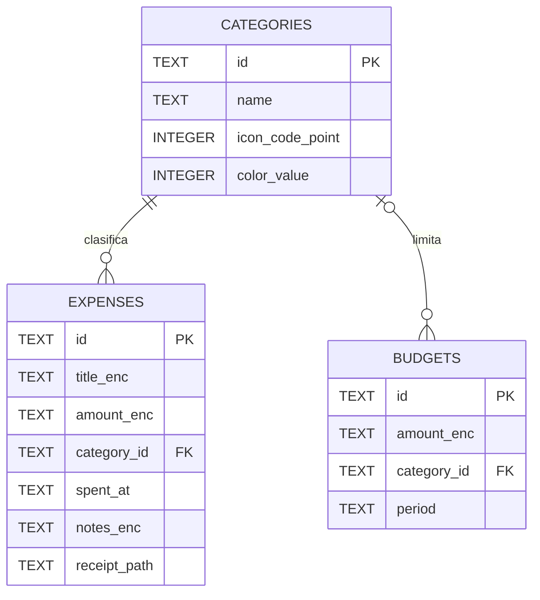

# Reporte técnico — Mis gastos

**Tipo:** MVP móvil Flutter  
**Plataformas:** Android e iOS  
**Persistencia:** SQLite local; Firebase Auth y Cloud Firestore opcionales  
**Estado de verificación:** `flutter analyze` limpio y `flutter test` aprobado

## 1. Objetivo y alcance

Mis gastos permite registrar y administrar gastos personales sin conexión. Incluye seis categorías iniciales, presupuestos semanales generales y por categoría, resumen gráfico, búsqueda y filtro mensual, captura y vista segura de tickets, y notificaciones locales al llegar al 80% de un presupuesto. La autenticación y sincronización con Firebase son opcionales; el CRUD local no requiere cuenta.

## 2. Arquitectura

La interfaz Flutter recibe los servicios desde `ExpenseApp`. `ExpenseRepository` gestiona SQLite, archivos privados y cifrado mediante `SecureCodec`. `CloudService` encapsula Firebase Auth y Firestore; `BudgetNotifications` programa la notificación local.

### Componentes

| Componente | Responsabilidad |
|---|---|
| `DashboardPage` | Presenta el resumen, historial, filtros, formularios, presupuestos y estados de carga/error. |
| `ExpenseRepository` | CRUD SQLite, migraciones, relaciones, archivos privados y eliminaciones pendientes de sincronización. |
| `SecureCodec` | Cifra y descifra texto e imágenes con AES-GCM. |
| `CloudService` | Inicio de sesión, registro, restablecimiento de contraseña y réplica por usuario en Firestore. |
| `BudgetNotifications` | Solicita permiso cuando corresponde y programa/cancela la alerta local de umbral. |

## 3. Modelo de datos

### Diagrama entidad-relación

La tabla de soporte `sync_deletions` registra los identificadores y tipos de elementos eliminados mientras no hay conexión. El esquema actual es versión 2; la migración crea esa tabla al actualizar una base local versión 1.

| Tabla | Campos | Reglas y relaciones |
|---|---|---|
| `categories` | `id`, `name`, `icon_code_point`, `color_value` | Catálogo de seis categorías. |
| `expenses` | `id`, `title_enc`, `amount_enc`, `category_id`, `spent_at`, `notes_enc`, `receipt_path` | `category_id` obligatorio y relacionado con `categories.id`. Título, importe y notas se guardan cifrados. |
| `budgets` | `id`, `amount_enc`, `category_id`, `period` | `category_id` nulo representa el límite global; si tiene valor, aplica a esa categoría. El periodo usado por el MVP es `weekly`. |
| `sync_deletions` | `id`, `entity` | Clave primaria compuesta (`id`, `entity`); conserva eliminaciones pendientes de propagar a la nube. |

El presupuesto y las alertas consideran gastos de los últimos siete días. El resumen por categoría muestra los gastos registrados y el historial puede limitarse al mes actual o buscar por descripción.

## 4. Persistencia, sincronización y errores

1. Los gastos y presupuestos se escriben primero en SQLite local.
2. Al iniciar sesión, la app vincula la copia local al primer UID autenticado. No permite sincronizar esa copia con un UID diferente.
3. La primera descarga remota se combina por ID con los datos locales; en conflictos prevalece el registro local. Antes de reemplazar el snapshot local se completa la descarga remota.
4. La sincronización replica los elementos actuales y elimina de Firestore los documentos que ya no están en el snapshot. Las eliminaciones locales pendientes se conservan hasta que la sincronización termina.
5. Si la red o Firestore fallan, se presenta el error y los datos locales se mantienen. El usuario autenticado puede reintentar la sincronización o hacerlo mediante el gesto de actualizar.

Los documentos remotos contienen descripciones, importes, fechas, notas, categorías y límites en texto legible para Firestore. El SDK de Firebase protege el transporte; **la app no aplica cifrado de extremo a extremo a los datos sincronizados**. Las imágenes de los tickets no se suben a la nube.

## 5. Seguridad y privacidad

1. **Cifrado local:** `cryptography` utiliza AES-GCM de 256 bits y un nonce nuevo por operación. Se cifran importes, títulos, notas, presupuestos y bytes de los tickets antes de persistirlos.
2. **Clave:** se crea una clave aleatoria de 256 bits y se almacena con `flutter_secure_storage` en el Keychain de iOS o Keystore de Android. No se incluye en el repositorio ni se registra. Si se pierde la clave, los datos locales cifrados no se pueden recuperar.
3. **Datos locales auxiliares:** SQLite conserva sin cifrar identificadores, relaciones, fecha del gasto y ruta relativa del ticket; el contenido binario de la imagen sí se cifra. La aplicación guarda la base y los archivos en su espacio privado.
4. **Firebase Auth:** Firebase administra las credenciales y los tokens. La contraseña no se guarda en SQLite ni en Firestore. Los errores se traducen a mensajes localizados; la respuesta de restablecimiento no revela si un correo está registrado.
5. **Reglas Firestore:** `firestore.rules` limita lectura y escritura al UID autenticado y a las subcolecciones `expenses` y `budgets`. Estas reglas deben desplegarse en el proyecto Firebase.
6. **Validación:** se validan importes finitos y positivos, límite máximo, formato del correo, longitud mínima de contraseña y longitud de título/notas. Los datos remotos también se validan antes de importarse.
7. **Permisos:** Android declara cámara y notificaciones; iOS declara el motivo de uso de cámara. El permiso de notificaciones se solicita al inicializar el plugin en las plataformas correspondientes.
8. **Tickets:** la imagen se cifra antes de guardarse. La vista previa se descifra para mostrarla en memoria con zoom; no se persiste una copia temporal descifrada.

## 6. Servicios, sensores y dependencias

| Paquete | Uso |
|---|---|
| `sqflite` | Persistencia SQLite y migraciones de esquema. |
| `cryptography` | Cifrado AES-GCM local. |
| `flutter_secure_storage` | Almacenamiento seguro de la clave y del UID propietario de los datos locales. |
| `firebase_auth`, `firebase_core` | Inicialización y autenticación opcional mediante correo/contraseña. |
| `cloud_firestore` | Sincronización autenticada de gastos y presupuestos. |
| `image_picker` | Captura de tickets con la cámara. |
| `fl_chart` | Gráfico de gastos por categoría. |
| `intl` | Formato de moneda y fechas para México. |
| `flutter_local_notifications`, `timezone` | Programación local del aviso de presupuesto. |
| `path_provider`, `path` | Acceso al espacio privado de archivos de la app. |
| `uuid` | Identificadores de registros y archivos de tickets. |

## 7. Verificación

En Flutter 3.50.1:

- `dart format lib test`: ejecutado.
- `flutter analyze`: sin problemas.
- `flutter test`: aprobado; incluye pruebas de importes, correo, contraseña, filtros de historial y mensajes seguros de autenticación.
- `plutil -lint ios/Runner/Info.plist`: válido.

La compilación/ejecución en dispositivo y las pruebas de extremo a extremo de cámara, notificaciones y Firebase requieren los SDK de plataforma, permisos del dispositivo y credenciales/proyecto Firebase. No se afirman como verificadas aquí.

## 8. Repositorio y entrega

Repositorio público: <https://github.com/xGodlight/gastos_flutter>.

- Ramas: `main`, `develop`, `feature/login`, `feature/receipt-preview`, `feature/expense-management` y `hotfix/sqlite-sync-migration`.
- PR de `feature/login` a `develop`: <https://github.com/xGodlight/gastos_flutter/pull/1>.
- Autorevisión documentada en [`revision-feature-login.md`](./revision-feature-login.md).
- README e instrucciones de instalación: [`../README.md`](../README.md).
